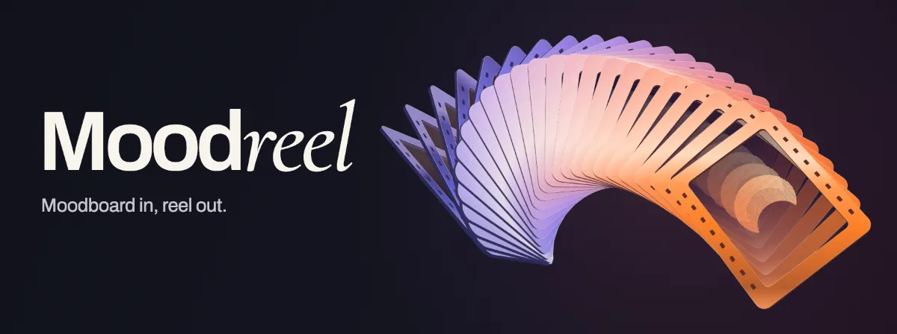
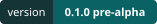
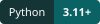
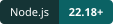
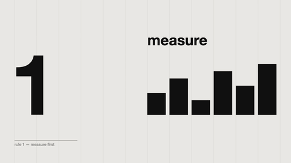
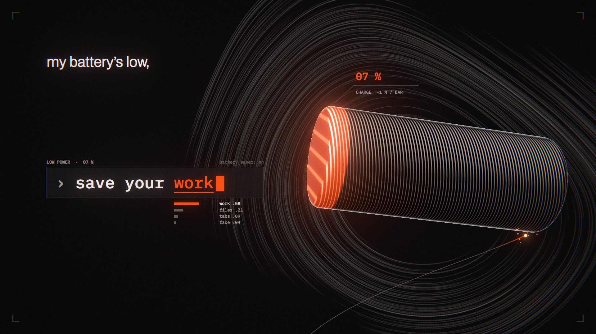
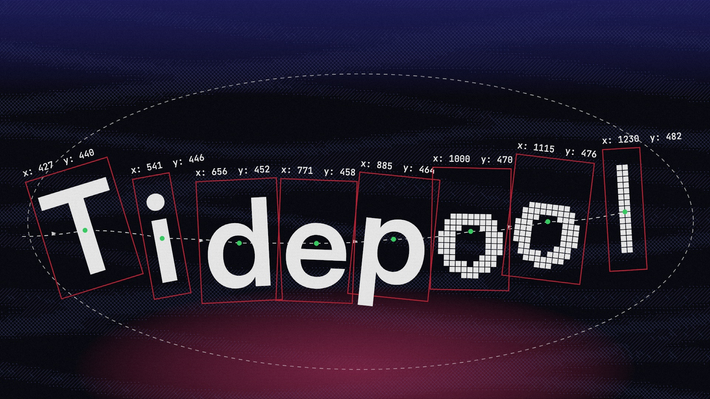

<h1 align="center">
  <picture>
    <source media="(prefers-reduced-motion: reduce)" srcset="docs/assets/moodreel-cover.webp">
    
  </picture>
</h1>

<p align="center"><strong>Measure a motion style from references and draw new films with it in code.</strong></p>
<p align="center">
  <a href="CHANGELOG.md"></a>
  <a href="pyproject.toml"></a>
  <a href="package-lock.json"></a>
  <a href="#license-and-credits"></a>
</p>

<p align="center"><b>English</b> · <a href="README.zh-CN.md">简体中文</a></p>
<p align="center"><a href="#quickstart">Quickstart</a> · <a href="#showcase">Showcase</a> · <a href="#make-a-film">Use with an agent</a> · <a href="#how-it-works">How it works</a> · <a href="#contributing">Contribute</a></p>

Moodreel is a local CLI and director skill for motion designers and creative coders. Give it a clip and it measures details you can carry into a different film, from the colours on screen to the spacing between successive entrances. Or pick a style from the library and start drawing. [Browse the style library](styles/README.md)

## Quickstart

Render *First Light*, a 12-second risograph sunrise, then use the MP4 as input to the measurement tools. The example includes its artwork and runs locally without an API key.

**Requirements** — Python 3.11+, uv, Node.js 22.18+ with npm, and FFmpeg with both `ffmpeg` and `ffprobe` on your path. The first install downloads dependencies and Puppeteer's Chrome. [Install uv](https://docs.astral.sh/uv/getting-started/installation/) · [Get FFmpeg](https://ffmpeg.org/download.html)

```sh
git clone https://github.com/gnipbao/moodreel.git
cd moodreel
uv sync --locked
npm ci
```

**1. Render the film.** Two spot inks print a sunrise. Where they overlap, a third colour appears. Open `out/first-light.mp4` to watch the result.

```sh
uv run moodreel render video examples/first-light --size 1280x720 --fps 24 --engine chrome --out out/first-light.mp4
```

**2. Measure the same film.** The report in `out/print-study/MEASURE.md` describes the colour roles, surface and motion it found. Compare it with the drawing code to see which choices the measurements recover. [First Light source](examples/first-light/main.js)

```sh
uv run moodreel intake out/print-study out/first-light.mp4
uv run moodreel measure out/print-study
```

## Showcase

| Swiss Programme · Swiss Motion Graphics | First Save · 16-bit Pixel RPG |
| :--- | :--- |
| <picture><source media="(prefers-reduced-motion: reduce)" srcset="docs/assets/swiss-programme.jpg"></picture> | <picture><source media="(prefers-reduced-motion: reduce)" srcset="docs/assets/first-save.jpg"></picture> |
| A grid, two rules and one red exception in a 15-second title sequence. [Treatment](examples/swiss-programme/TREATMENT.md) · [Drawing code](examples/swiss-programme/main.js) | A 320 × 180 pixel world with parallax ridges, a walking character and a save prompt. [Treatment](examples/first-save/TREATMENT.md) · [Drawing code](examples/first-save/main.js) |

[Browse all example films](examples/README.md) · [Preview sources and credits](docs/assets/README.md)

### Style library

Browse 59 imported style guides and three packs distilled with Moodreel. Each of the three packs below includes a style guide, a ledger tracing its values to evidence, a drawing kit and the source for its demo film. [All styles](styles/README.md) · [Install a pack](packs/README.md)

| [Ink Chronicle](packs/east-asian-traditions/ink-chronicle/README.md) | [Signal Plates](packs/graphic-type/signal-plates/README.md) | [ASCII Glitch Launch](packs/information-keynote/ascii-glitch-launch/README.md) |
| :---: | :---: | :---: |
|  |  |  |

## Make a film

To start with a built-in style, create a film folder, write its treatment in `films/launch/TREATMENT.md` and draw the scenes in `films/launch/main.js`. The template points to the chosen style's rules. The examples show how to translate them into a finished film. [Example films and source](examples/README.md)

```sh
uv run moodreel styles swiss
uv run moodreel film new launch --style swiss-motion
```

Once the scenes are ready, run `uv run moodreel film deliver films/launch` to render the MP4 and poster, then `uv run moodreel film check films/launch` to check the rendered video for black frames and the text for reading time.

**With a coding agent**, open this checkout and give the agent a brief like the one below. The director skill covers the treatment, drawing, review and delivery. [Director skill](skills/moodreel/SKILL.md)

> Read `skills/moodreel/SKILL.md` and use `uv run moodreel`. Make a 15-second title sequence for a night train in the Swiss Motion Graphics style. Show me a style frame before rendering the film.

## How it works

1. **Measure the references.** The CLI reads palette, surface, type and layout from images. A clip also gives it timing, easing and stagger. The results go into `MEASURE.md`.
2. **Build the style pack.** The director describes the reusable rules in `STYLE.md` and records the evidence behind each value in `LEDGER.md`. A style frame and demo film put the drawing kit to the test. [Distillation workflow](docs/workflows.md#distill-a-style-pack)
3. **Draw new scenes.** A film's JavaScript function `window.render(t)` draws the frame at time `t`. The renderer can seek directly to a still or encode the frames to an MP4. [Drawing guide](skills/moodreel/references/produce/drawing.md) · [Renderer](render/render.mjs)

## Documentation

| I want to… | Start here |
| --- | --- |
| Distill my own references into a pack | [Distillation workflow](docs/workflows.md#distill-a-style-pack) |
| Add a score, footage or narration, or export to HyperFrames or Remotion | [Production and delivery](docs/workflows.md#produce-and-deliver-a-film) |
| Compare a remake with a reference, shot by shot | [Shot analysis](docs/workflows.md#compare-a-remake-with-its-reference) |
| Write a scene or a reusable drawing primitive | [JavaScript kit](kit/README.md) · [Drawing guide](skills/moodreel/references/produce/drawing.md) |

**Measurement accuracy.** On 12 code-rendered test films with known motion, the clean run found 95 of 99 target properties and reported 25 spurious detections. Calibration on real-world references and human evaluation are still open. [Benchmark results](bench/motion/REPORT.md) · [Evaluation and limits](docs/workflows.md#evaluate-the-measurements) · [Changelog](CHANGELOG.md)

## Contributing

Bug reports, documentation fixes and contributions are welcome. For a rendering issue, include the command, your OS and a small example others can run. [Open an issue](https://github.com/gnipbao/moodreel/issues) · [Contributor setup and pull requests](CONTRIBUTING.md)

## License and credits

Moodreel's core uses the MIT license. The imported style guides retain LemoLab's MIT notice. The optional `kit/3dcv/` port from 3DCodeVerse uses **CC BY-NC-SA 4.0**. Including it with `--with 3dcv` makes the resulting film non-commercial under the port's license. Credit the source and share adaptations of the port under the same terms. [Core license](LICENSE) · [Style credits](styles/LICENSE-lemo-opuscar) · [3DCodeVerse terms](kit/3dcv/LICENSE) · [Third-party notices](NOTICE) · [Acknowledgements](docs/workflows.md#acknowledgements)
