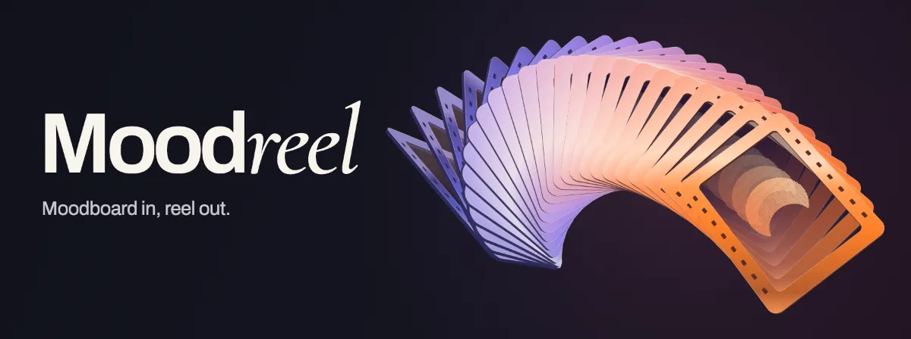
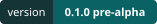
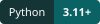
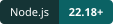
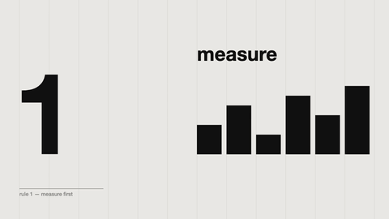
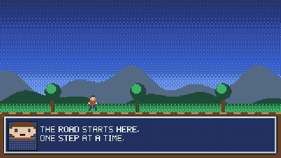
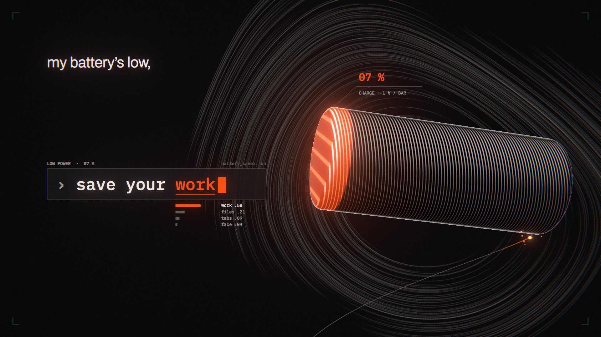
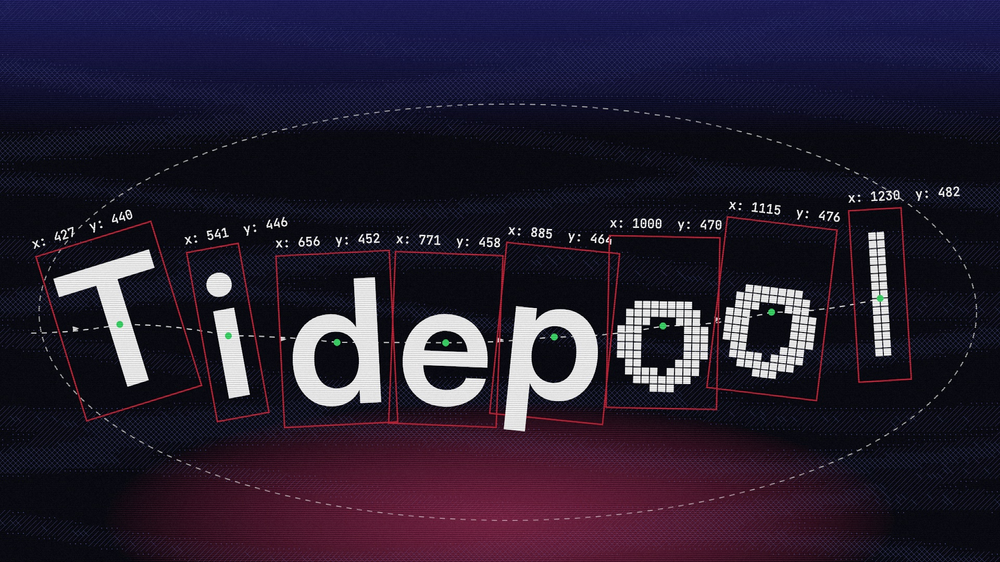

<h1 align="center">
  <picture>
    <source media="(prefers-reduced-motion: reduce)" srcset="docs/assets/moodreel-cover.webp">
    
  </picture>
</h1>

<p align="center"><strong>从参考素材中测出动态视觉风格，用代码绘制同风格的新片。</strong></p>
<p align="center">
  <a href="CHANGELOG.md"></a>
  <a href="pyproject.toml"></a>
  <a href="package-lock.json"></a>
  <a href="#许可证与致谢"></a>
</p>

<p align="center"><a href="README.md">English</a> · <b>简体中文</b></p>
<p align="center"><a href="#快速开始">快速开始</a> · <a href="#作品展示">作品展示</a> · <a href="#制作自己的短片">智能体创作</a> · <a href="#工作原理">工作原理</a> · <a href="#参与贡献">参与贡献</a></p>

Moodreel 为动态设计师和创意开发者提供本地命令行工具和导演技能。给它一段参考短片，就能测出画面里用了哪些颜色、元素入场相隔多久，再把这些设计选择用在另一部片上。你也可以直接从风格库选一种风格开拍。[浏览风格库](styles/README.md)

## 快速开始

先渲染《First Light》，一部用孔版套色印刷风格描绘日出的 12 秒短片，再用生成的 MP4 做一次风格测量。示例自带画面源文件，本地运行无需 API 密钥。

**运行环境**需要 Python 3.11+、uv、Node.js 22.18+（含 npm）和 FFmpeg。请确保终端能找到 `ffmpeg` 和 `ffprobe`。首次安装会下载依赖及 Puppeteer 使用的 Chrome。[安装 uv](https://docs.astral.sh/uv/getting-started/installation/) · [下载 FFmpeg](https://ffmpeg.org/download.html)

```sh
git clone https://github.com/gnipbao/moodreel.git
cd moodreel
uv sync --locked
npm ci
```

**1. 渲染短片。** 两种专色印出日出的海面，油墨重叠处显出第三种颜色。运行后打开 `out/first-light.mp4` 即可观看。

```sh
uv run moodreel render video examples/first-light --size 1280x720 --fps 24 --engine chrome --out out/first-light.mp4
```

**2. 测量这部片。** 打开 `out/print-study/MEASURE.md`，查看测出的色彩分工、表面质感和运动特征。对照示例的绘制源码，就能看出哪些设计选择被测了回来。[查看《First Light》绘制源码](examples/first-light/main.js)

```sh
uv run moodreel intake out/print-study out/first-light.mp4
uv run moodreel measure out/print-study
```

## 作品展示

| Swiss Programme · 瑞士动态排版 | First Save · 16 位像素 RPG |
| :--- | :--- |
| <picture><source media="(prefers-reduced-motion: reduce)" srcset="docs/assets/swiss-programme.jpg"></picture> | <picture><source media="(prefers-reduced-motion: reduce)" srcset="docs/assets/first-save.jpg"></picture> |
| 一张网格、两条排版规则，以及一块偏离网格的红色方块。片头全长 15 秒。[创作方案](examples/swiss-programme/TREATMENT.md) · [绘制源码](examples/swiss-programme/main.js) | 在 320 × 180 像素的世界里，角色穿过有视差的山岭，遇到第一个存档点。[创作方案](examples/first-save/TREATMENT.md) · [绘制源码](examples/first-save/main.js) |

[浏览全部示例短片](examples/README.md) · [预览素材来源与署名](docs/assets/README.md)

### 风格库

仓库收录了 59 套从上游导入的风格指南，以及用 Moodreel 蒸馏出的 3 套完整风格包。下面每套风格包都附有风格指南、记录参数依据的台账、绘制工具和演示片源码。[浏览全部风格](styles/README.md) · [安装风格包](packs/README.md)

| [墨字列传](packs/east-asian-traditions/ink-chronicle/README.md) | [信号图版](packs/graphic-type/signal-plates/README.md) | [字符故障发布片](packs/information-keynote/ascii-glitch-launch/README.md) |
| :---: | :---: | :---: |
|  |  |  |

## 制作自己的短片

先选一种内置风格，创建影片目录。在 `films/launch/TREATMENT.md` 里写创作方案和分镜，在 `films/launch/main.js` 里绘制场景。方案模板里有该风格指南的路径，示例目录里可以看到同一套规则怎样变成成片。[示例短片与源码](examples/README.md)

```sh
uv run moodreel styles swiss
uv run moodreel film new launch --style swiss-motion
```

场景完成后，运行 `uv run moodreel film deliver films/launch` 渲染 MP4 和海报，再用 `uv run moodreel film check films/launch` 检查成片是否有黑帧、文字停留时间是否足够。

**使用编程智能体时**，在仓库目录打开会话，把下面的需求交给它。导演技能里写明了从创作方案、绘制、审片到交付的做法。[导演技能](skills/moodreel/SKILL.md)

> 阅读 `skills/moodreel/SKILL.md`，用 `uv run moodreel` 制作一段 15 秒的夜班列车片头。采用瑞士动态排版风格，先给我看一张风格帧，再渲染全片。

## 工作原理

1. **测量参考。** 命令行工具从图片中读取配色、质感、排版和布局。有视频时，还能测出时长、缓动曲线和多个元素入场的时间差，结果写进 `MEASURE.md`。
2. **制作风格包。** 导演把可复用的规则写进 `STYLE.md`，把每个参数的依据记进 `LEDGER.md`，再用一张风格帧和一部演示片检验绘制工具。[风格蒸馏流程](docs/workflows.zh-CN.md#从参考素材蒸馏风格包)
3. **绘制新场景。** 每部短片的 JavaScript 函数 `window.render(t)` 负责画出时刻 `t` 的一帧。渲染器可以直接跳到某一帧出静图，也可以把整段画面编码成 MP4。[绘制指南](skills/moodreel/references/produce/drawing.md) · [渲染器源码](render/render.mjs)

## 文档导航

| 我想做什么 | 从这里开始 |
| --- | --- |
| 把自己的参考素材整理成风格包 | [风格蒸馏流程](docs/workflows.zh-CN.md#从参考素材蒸馏风格包) |
| 加配乐、素材或旁白，导出为 HyperFrames 或 Remotion 项目 | [影片制作与交付](docs/workflows.zh-CN.md#制作与交付影片) |
| 逐镜对照参考，找出复刻片的差异 | [逐镜分析](docs/workflows.zh-CN.md#逐镜比较复刻和参考) |
| 编写场景或可复用的绘制函数 | [JavaScript 工具包](kit/README.md) · [绘制指南](skills/moodreel/references/produce/drawing.md) |

**测量精度。** 在 12 部动作参数已知的代码测试片上，原始画质组的 99 项目标属性中检出了 95 项，同时产生了 25 项误报。真实参考素材的校准与人工评估仍待完成。[逐片基准报告](bench/motion/REPORT.md) · [测量精度与局限](docs/workflows.zh-CN.md#了解测量精度) · [更新日志](CHANGELOG.md)

## 参与贡献

欢迎提交问题、改进文档或贡献代码。反馈渲染问题时，请附上运行命令、操作系统和一个可复现的小示例。[提交 Issue](https://github.com/gnipbao/moodreel/issues) · [贡献环境与 PR 指南](CONTRIBUTING.md)

## 许可证与致谢

Moodreel 核心代码使用 MIT 许可证。导入的风格指南保留 LemoLab 的 MIT 声明。可选的 3DCodeVerse 移植模块 `kit/3dcv/` 使用 **CC BY-NC-SA 4.0**。用 `--with 3dcv` 将其纳入影片后，成片仅限非商业用途，须注明来源，对该模块的改编须按相同许可共享。[核心许可证](LICENSE) · [风格库许可](styles/LICENSE-lemo-opuscar) · [3DCodeVerse 模块许可](kit/3dcv/LICENSE) · [第三方声明](NOTICE) · [项目致谢](docs/workflows.zh-CN.md#致谢)
